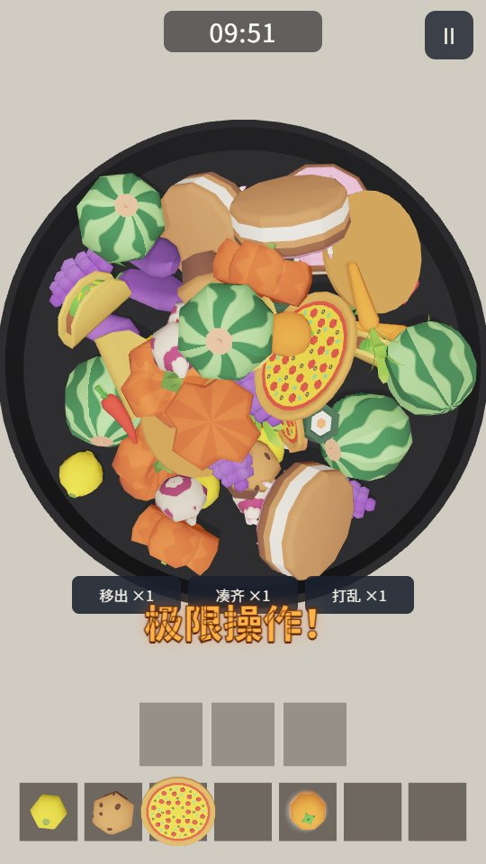
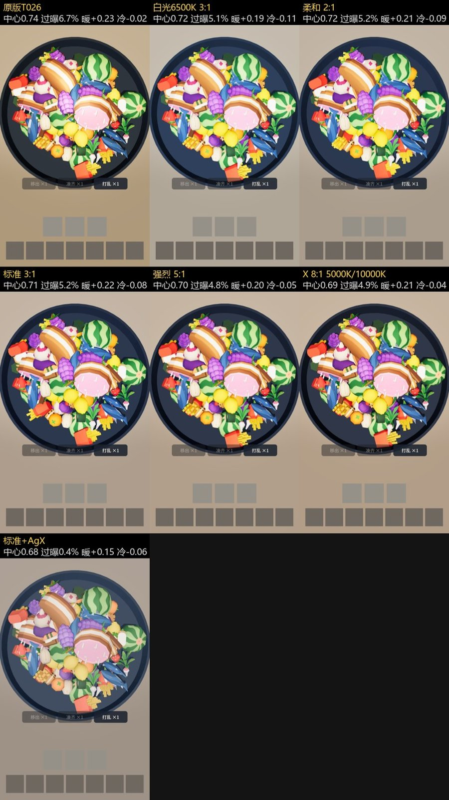
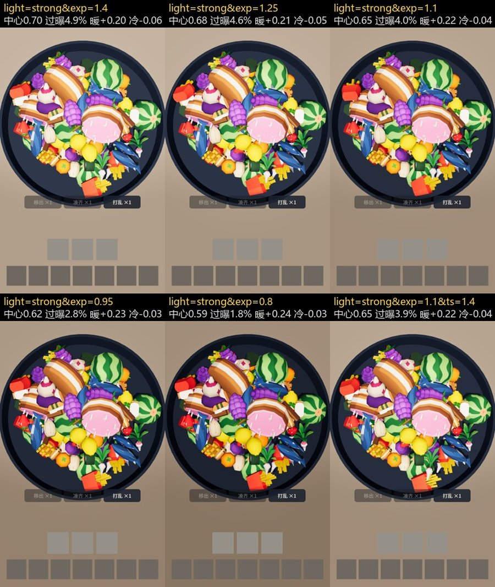
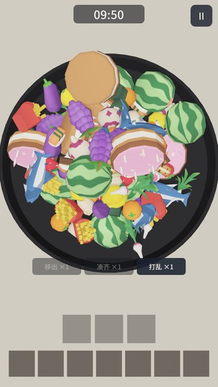
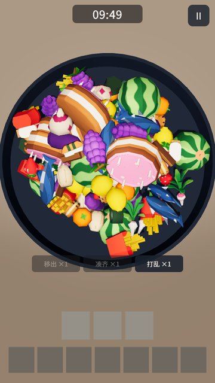

::: {.callout-tip appearance="simple"}
**Play the updated build:** [Harvest Pile (single-file web build)](../harvest-pile/play/index.html). Tap an item to pick it. **Press and hold on an empty spot, then drag slowly** to dig through the pile.
:::

[Part 1](../harvest-pile/) ended with a prototype that *worked*: the pile was stable, every level was solvable, and the web build loaded fast. Playing it was another matter. Items kept flipping over at rest. The "dig" gesture was a radial wind that blew half the bowl away. Matches cleared with no weight to them, and the lighting was flat and slightly over-exposed in the middle.

This post covers the week spent on **game feel**: what I used as references, what changed, and how each change was implemented and measured.

## The framework: fix one layer at a time, from the inside out

The most useful single reference was Pichlmair and Johansen's survey *Designing Game Feel* [1]. It splits game feel into three layers:

| Layer | Question | In this game |
|---|---|---|
| **Physicality** | How do things move on their own? | mass, damping, how the pile settles, how digging pushes items |
| **Support** | Can the player do what they mean? | tap priority, hit areas, input buffering, first-frame latency |
| **Amplification** | How much does each action pay off? | hit-stop, particles, sound, labels |

The ordering rule I took from it: **do not add amplification on top of a physics layer that is still wrong**, because effects hide physical problems instead of fixing them. Two other references set the method. MDA [2] says to define the target experience first ("calm, tactile sorting with a bit of tension") and judge every change against it. Swink's *Game Feel* [3] frames the whole thing as real-time control plus simulated space plus polish.

Every change was made switchable and parameterised in a single tuning file, so I could compare before and after by flipping a URL flag.

The division of labour stayed as in Part 1. Claude wrote specs with measurable acceptance tests. A headless coding agent, now running on the DeepSeek API, implemented them. I played every build and decided what felt right. The rake section shows why that last step cannot be automated away.

## Layer 1, Physicality: a pile that is calm but not dead

**Symptoms:** items flipped over at rest, light items behaved like heavy ones, and the pile looked jittery.

**Changes:**

- **Mass from volume.** Mass is now `clamp(density × bounding-box volume, min, max)` instead of a fixed cycle of values. A watermelon now shoulders a cherry aside instead of the other way round.
- **Asymmetric damping.** Each physics step multiplies horizontal velocity by `exp(-k_h · dt)`, while vertical velocity keeps only a small engine damping. Sliding dies out quickly, but falling and collapsing stay crisp. A single isotropic damping made items look as if they were falling through syrup.
- **Angular damping plus a hard angular-speed cap,** so a rare spike from the contact solver cannot spin an item.
- **"Lie flat" torque.** When an item is almost at rest, a small torque rotates its thinnest visual axis toward vertical, so a slice of bread lies flat instead of balancing on its edge. A dead zone stops it from oscillating near the target. Items that are pinned under others are left alone.
- **Faster sleep.** The sleep thresholds went from 0.15 m/s / 0.35 s to 0.22 m/s / 0.22 s, so a settled pile actually goes to sleep.

**How it was measured:** "flips while resting for 5 s" and "flips after all raking ends" are counted over every item on the board. Both went to 0 of 110 in the native build and 0 of 144 on the web.

I also considered Reynolds' boids [4] to make the pile move as one mass. I did not use the algorithm. I kept only two of its ideas: **cohesion**, a weak pull toward the bowl centre that doubles when fewer than 30 items remain so the late game stays a compact cluster, and **alignment**, which became the lie-flat torque above.

## Layer 3, Amplification: making a match land

The amplification references were mostly from action games: hit-stop [5], and two longer pieces on hit feedback and readability [6][7]. The key idea from them is that **impact comes from timing, not from size**. A short freeze at the moment of contact reads as weight, and the effect must fire on the same frame as the input.

{width=300}

| Event | What happens | Numbers |
|---|---|---|
| Tap an item | hit-stop: the item freezes and swells slightly before it flies | 0.11 s, ×1.08 scale |
| Third item lands | the three items squash toward each other, then burst | smoke: 9 puffs, 0.8 → 2.2 slot widths, opaque for 60% of the lifetime; debris: 8 chips in the item's main colour |
| Burst + 80 ms | a small praise label pops | 0.15 s pop (0.5 → 1.12 → 1.0), 0.65 s hold, 0.2 s fade |
| Every event | a sound on the same frame as the animation | see below |

Effect sizes use **the slot width as the unit**, not world metres, so the effect is always readable where the player is looking.

One timing bug is worth mentioning. In Godot, `set_parallel(true)` on a tween makes *every* following step parallel. The fade started at the same moment as the hold, so the label was already fading when it appeared. Using `.parallel()` on only the steps that should overlap fixed it.

### Sound

The second sound set is built by a script from 26 CC0 recordings on freesound.org, plus FluidSynth notes and procedural synthesis (full credits below). Design rules:

- Items are grouped into **five materials** (firm, soft, crisp, heavy, light). Each material has three pick variants and three insert variants, so repeated taps do not sound identical.
- Match chimes **rise in pitch** with the combo step.
- There are three sub-buses (foley, reward, UI). Reward sounds briefly **duck** the foley bus.
- At most four instances of the same sound play at once.

**Things I decided against:** screen shake and phone vibration. Eiserloh's trauma-based camera shake [8] is a good model, but in a calm sorting game a shaking camera works against the target experience. Picking a sushi roll should not feel like being punched.

## Lighting: photographic standards instead of taste

The first lighting pass produced the usual loop: an AI agent tweaks values, I look, I say "a bit too bright", and it repeats. Neither side's taste converges. So I switched to **standards from photography** and **a contact sheet**:

1. **Key-to-fill ratio.** Portrait photography describes contrast as the ratio of lit-side to shadow-side illuminance: 2:1 is soft, 3:1 standard, 5:1 dramatic. A preset generator keeps the total illuminance on the lit side constant and only changes this ratio. That way presets differ in contrast, not in overall brightness.
2. **Colour temperature in Kelvin.** The food items are saturated warm colours (orange, red, yellow). Under a warm key light they blend together. The presets use a **near-neutral key (5000–5600 K)** and a **cool fill (7500–10000 K)**: the "teal and orange" split from film grading, where the cool shadows make the warm objects stand out. Kelvin values are converted to RGB with Tanner Helland's approximation [9], normalised so that 6500 K is white.
3. **Contact sheet.** A headless-Chrome script renders the same seed and frame under every preset and assembles them into one image, annotated with centre brightness, percentage of clipped pixels, and a warm/cool balance. I picked from the sheet in one pass.

{width=640}

The sheet turned up something I would not have guessed. **With a nearly top-down camera, the key:fill ratio and colour temperature barely change the image. Exposure dominates.** Most visible surfaces face the camera, so they see key and fill light about equally. A second sheet swept only exposure, and that one made the choice easy.

{width=640}

**Final choice:** 5:1, 5200 K key, 9000 K fill, exposure 1.4 → 0.95. The hot spot in the middle came from a warm point light; it was cut to a weak neutral one. Tone mapping stayed ACES: AgX looked washed out on these saturated colours. The same numbers were converted to the native Godot build.

::: {layout-ncol=2}



:::

## The hard one: digging with your finger

This took four attempts, and it is the clearest lesson of the week.

The target, in the playtester's words: press into the pile and push gently, **like a dog digging in sand**. Items under the finger get pushed out to the rim of a hole. Holding still makes the hole deeper. Moving the finger drags the hole along. The effect has to be strong enough to work, but limited enough never to blow the pile apart.

| Attempt | Model | Playtest verdict |
|---|---|---|
| 0 (Part 1) | radial wind around the cursor | far too strong: the whole bowl scatters |
| 1 | invisible kinematic capsule "rake" that follows the finger through a spring, slowed down by the mass it touches | too weak, and too dependent on hand speed; holding still does nothing |
| 2 | a vertical "hand" plunged about two layers deep, with the trench refilling after release | better depth, but still a surface drag; a rustle sound tied to speed was too loud |
| 3 | **a hemisphere repulsion field under the finger** | ✓ after one fix (below) |

### The hemisphere field

- **Shape.** The centre sits just below the pile surface under the finger. It affects the lower hemisphere plus a thin cap above the centre, so items on top of the pile and away from the finger are untouched. The radius is about one large item or two small ones: 0.8 m, in a bowl of radius 2.35 m.
- **Force.** The direction is horizontal from the centre to the item, plus an upward share. Items arc out over a small parabola and land at the rim. The magnitude is a **fixed strength × distance falloff, independent of hand speed**.
- **Texture.** A 5.5 Hz, ±20% pulse on the strength makes items move in small scoops rather than a smooth flow. The pulse starts at 1 on the first frame, so the press responds immediately.
- **Restraint.** At most the 10 nearest bodies are pushed per frame, item speed has a hard cap, and the field centre chases the finger at a limited speed. A fast flick just leaves the hole behind; it does not hit harder.
- **Digging and dragging.** Holding still sinks the centre deeper, up to about two layers. While dragging, the push direction is biased **backwards**, like scooping sand behind you. On release, the T029 refill lets the hole close up.
- **Sound.** Quiet noise grains generated in WebAudio, one per pulse, only while something in the field is moving: about 12 dB below the pick sound.

{width=300}

### The fix: tests can over-constrain feel

The implementing agent passed every acceptance test, including "a slow drag and a fast drag over the same path move the same number of items within 30%". To get there it added three constraints:

1. while moving, each item gets **one** fixed kick the first time the field reaches it;
2. while holding, each item stops being pushed once it has moved 0.45 m;
3. everything outside the field is **pinned horizontally** for the whole press, so far-away items cannot slide.

All three make the numbers clean. Together they also make the interaction feel dead. The first moment of a press pops a few items, and after that nothing responds. The playtest verdict was "it's like nothing changed".

Removing all three and applying the force **continuously while held** fixed it immediately. Speed independence still holds where it matters: a faster hand never produces a stronger push. It no longer holds in the strict sense the test measured, since a slow drag spends more time over the same items. That trade-off is fine for the player.

The general lesson: **a measurable proxy for feel is useful as a guard rail, but it is not the goal.** Specs need to say which numbers are hard constraints and which are just indicators. And somebody has to actually play the build.

## Takeaways

- **Layer order matters.** Fixing physics first made every later effect cheaper to tune, because the effects were not compensating for jitter.
- **Make timing exact before making effects big.** A 0.11 s hit-stop and a same-frame sound did more than doubling the particle count.
- **For aesthetics, use standards and a contact sheet, not round-by-round taste.** The sheet also showed which parameter actually mattered (exposure), which no amount of discussion would have.
- **Restraint is a design parameter.** The digging interaction only became good once "how much it is allowed to affect" (radius, body count, speed cap) was separated from "how strongly it pushes".
- **Play it.** All four rake versions had passing tests at some point.

## References

1. M. Pichlmair, M. Johansen. *Designing Game Feel: A Survey*. 2020. [arXiv:2011.09201](https://arxiv.org/abs/2011.09201)
2. R. Hunicke, M. LeBlanc, R. Zubek. *MDA: A Formal Approach to Game Design and Game Research*. AAAI Workshop on Challenges in Game AI, 2004. [PDF](https://users.cs.northwestern.edu/~hunicke/MDA.pdf)
3. S. Swink. *Game Feel: The Secret Ingredient*. Game Developer, 2007. [link](https://www.gamedeveloper.com/design/game-feel-the-secret-ingredient)
4. C. W. Reynolds. *Flocks, Herds, and Schools: A Distributed Behavioral Model*. SIGGRAPH 1987.
5. critpoints. *Hitstop / Hitfreeze / Hitlag / Hitpause*. 2017. [link](https://critpoints.net/2017/05/17/hitstophitfreezehitlaghitpausehitshit/)
6. 机核 (Gcores). *谈谈动作游戏的设计：操作与反馈、硬直* (on input feedback, effect feedback, and hit-stun). [link](https://www.gcores.com/articles/97115)
7. J. de Heras, translated by Gcores. *如何塑造动作游戏的打击感并传达游戏核心机制* (building hit feel and communicating core mechanics). [link](https://www.gcores.com/articles/167815)
8. S. Eiserloh. *Juicing Your Cameras With Math*. GDC 2016. [link](http://www.mathforgameprogrammers.com/)
9. T. Helland. *How to Convert Temperature (K) to RGB: Algorithm and Sample Code*. 2012. [link](https://tannerhelland.com/2012/09/18/convert-temperature-rgb-algorithm-code.html)

## Credits

**3D models.** [Food Kit](https://kenney.nl/assets/food-kit) by Kenney (kenney.nl), CC0.

**Sound effects.** Built from these freesound.org recordings, all CC0, plus procedural synthesis and FluidSynth. CC0 does not require attribution, but thank you all:

```{=html}
<ul class="small"><li>“coins - in cloth 06.wav” by Anthousai (<a href="https://freesound.org/people/Anthousai/sounds/336578/">#336578</a>)</li><li>“bass drumm from uke.flac” by arseniiv (<a href="https://freesound.org/people/arseniiv/sounds/707239/">#707239</a>)</li><li>“wood-click-3.wav” by husamalhomsi (<a href="https://freesound.org/people/husamalhomsi/sounds/500927/">#500927</a>)</li><li>“Short Woosh 04.wav” by ironcross32 (<a href="https://freesound.org/people/ironcross32/sounds/582895/">#582895</a>)</li><li>“owl-plonk stretched tenfold” by Jerimee (<a href="https://freesound.org/people/Jerimee/sounds/725408/">#725408</a>)</li><li>“Spoon hit 2” by MBPL (<a href="https://freesound.org/people/MBPL/sounds/667186/">#667186</a>)</li><li>“apple6.wav” by melack (<a href="https://freesound.org/people/melack/sounds/160238/">#160238</a>)</li><li>“splat04.wav” by moshang (<a href="https://freesound.org/people/moshang/sounds/460866/">#460866</a>)</li><li>“splat03.wav” by moshang (<a href="https://freesound.org/people/moshang/sounds/460867/">#460867</a>)</li><li>“ppop.wav” by Narjara (<a href="https://freesound.org/people/Narjara/sounds/527522/">#527522</a>)</li><li>“bubble pop 6” by nomentero (<a href="https://freesound.org/people/nomentero/sounds/744144/">#744144</a>)</li><li>“Fruit Impact 2” by OwlStorm (<a href="https://freesound.org/people/OwlStorm/sounds/209015/">#209015</a>)</li><li>“Fruit Impact 1” by OwlStorm (<a href="https://freesound.org/people/OwlStorm/sounds/209012/">#209012</a>)</li><li>“Fruit Impact 3” by OwlStorm (<a href="https://freesound.org/people/OwlStorm/sounds/209018/">#209018</a>)</li><li>“Puff of Smoke” by qubodup (<a href="https://freesound.org/people/qubodup/sounds/714257/">#714257</a>)</li><li>“LEGO Click 1” by rioforce (<a href="https://freesound.org/people/rioforce/sounds/233649/">#233649</a>)</li><li>“LEGO Brick Fall 6” by rioforce (<a href="https://freesound.org/people/rioforce/sounds/233642/">#233642</a>)</li><li>“LEGO Double Click 4” by rioforce (<a href="https://freesound.org/people/rioforce/sounds/233655/">#233655</a>)</li><li>“LEGO Brick Fall 8” by rioforce (<a href="https://freesound.org/people/rioforce/sounds/233640/">#233640</a>)</li><li>“WD-40 Lightly used can - Slam on wood 10” by Sadiquecat (<a href="https://freesound.org/people/Sadiquecat/sounds/738380/">#738380</a>)</li><li>“WD-40 Lightly used can - Slam on wood 6” by Sadiquecat (<a href="https://freesound.org/people/Sadiquecat/sounds/738385/">#738385</a>)</li><li>“Click_9” by SignatureSoundsOrg (<a href="https://freesound.org/people/SignatureSoundsOrg/sounds/872341/">#872341</a>)</li><li>“Kitchen_Foley_08” by SignatureSoundsOrg (<a href="https://freesound.org/people/SignatureSoundsOrg/sounds/868826/">#868826</a>)</li><li>“Topf 2.wav” by soundjoao (<a href="https://freesound.org/people/soundjoao/sounds/329962/">#329962</a>)</li><li>“Falling Box of Objects - 1.wav” by SpaceJoe (<a href="https://freesound.org/people/SpaceJoe/sounds/483643/">#483643</a>)</li><li>“Glass 03.wav” by totalcult (<a href="https://freesound.org/people/totalcult/sounds/388652/">#388652</a>)</li></ul>
```

**Music.** Public-domain scores, from MIDI files of the [Mutopia Project](https://www.mutopiaproject.org/). The two CC BY-SA 3.0 arrangements (Mozart K.545 I by Alejandro Sierra; Chopin Op. 9 No. 2 by Renato Biolcati Rinaldi) are shared under the same licence. Rendered with [FluidSynth](https://www.fluidsynth.org/) and the [GeneralUser GS](https://schristiancollins.com/generaluser.php) SoundFont by S. Christian Collins. Full per-piece credits are in [Part 1](../harvest-pile/#credits) and in the in-game pause menu.

**Engines and libraries.** [three.js](https://threejs.org/) (MIT), [JoltPhysics.js](https://github.com/jrouwe/JoltPhysics.js) (MIT), [Godot Engine](https://godotengine.org/) (MIT).

**Tools.** Specs and review by Claude (Anthropic). Implementation by a headless coding agent on the DeepSeek API.
