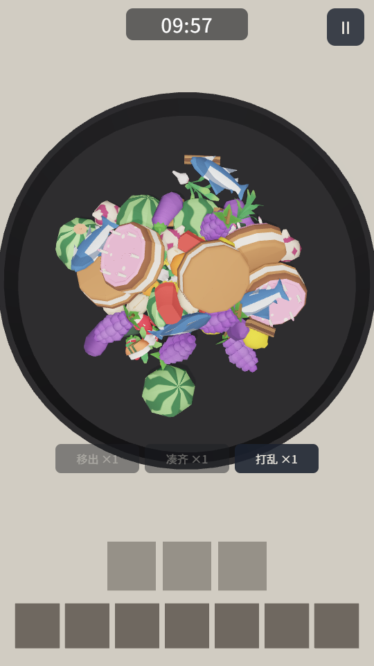
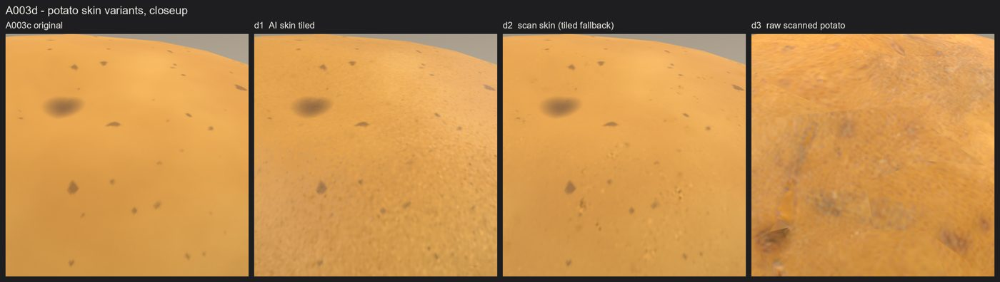
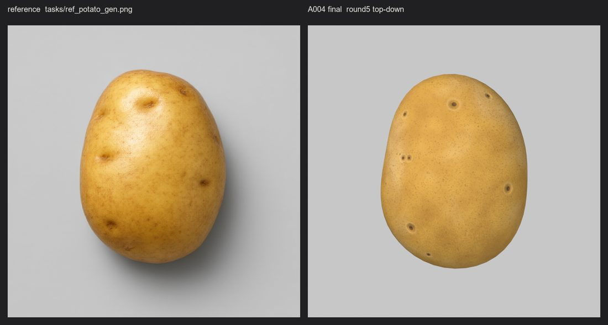
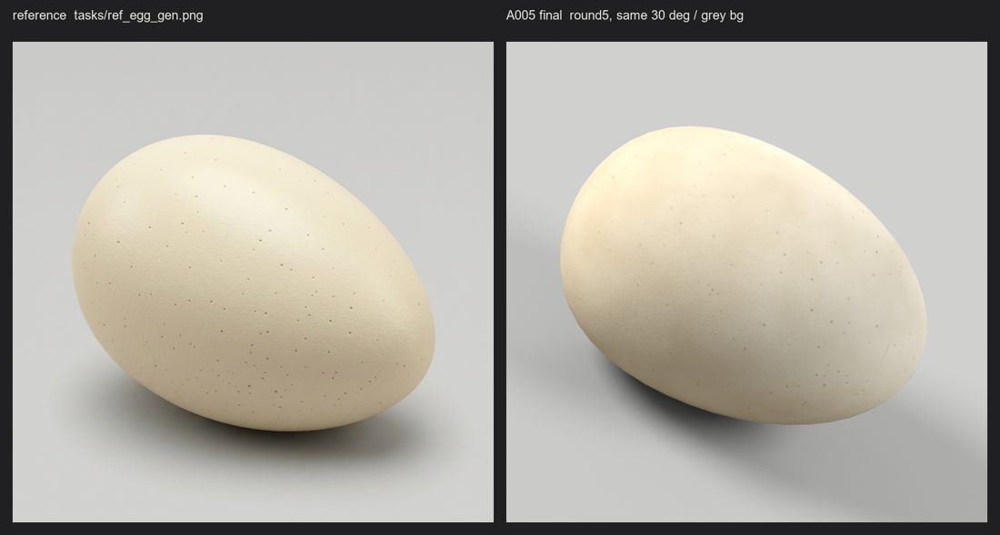
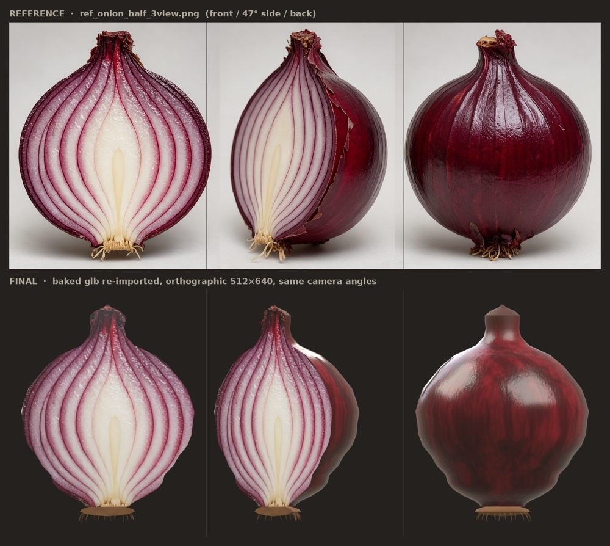
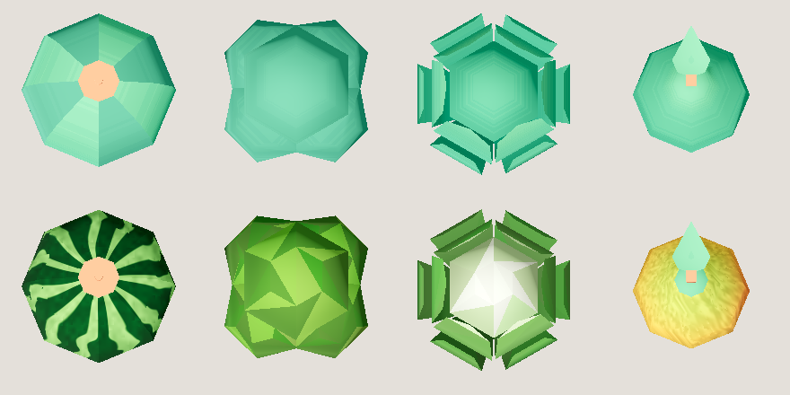
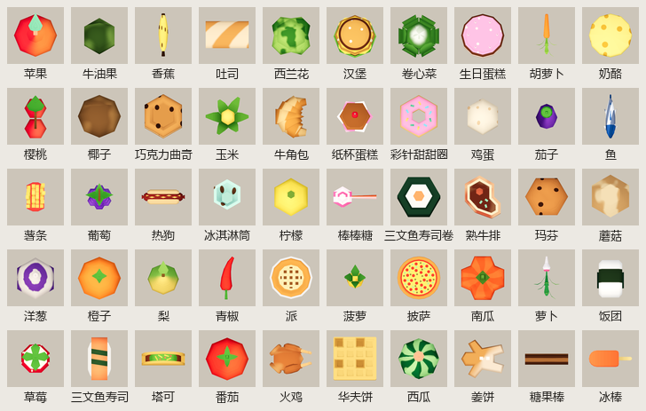

::: {.callout-tip appearance="simple"}
**Play it:** [Harvest Pile (single-file web build)](play/index.html) — runs in any modern browser, desktop or phone. Tap an item to send it to the tray; three of a kind clear. Sound starts after the first tap.
:::

{width=360}

## What this is

*Harvest Pile* is a small prototype in the "3D match" genre: a few dozen food items are dropped into a bowl and pile up under real rigid-body physics. You dig through the pile, pick items into a 7-slot tray, and every three identical items clear. Fill the tray without a match and you lose; empty the bowl and you win.

I built it in about two weeks as a deliberate **baseline**: reproduce the mechanics of an existing genre first, measure what makes it feel good, and only then change the design. The genre looks trivial, but a surprising amount of engineering hides behind "a pile of stuff you can tap":

- the pile has to look alive but must never jitter or explode;
- the level must always be solvable without being trivially easy;
- 30 item types must be distinguishable at thumbnail size on a phone;
- the web build has to load fast and must not stutter on the very first tap.

This post collects what I learned, with the formulas and code that ended up in the game.

## How it was built: one designer agent, one implementer agent

The project was also an experiment in **AI-assisted development with a strict division of labour**:

| Role | Who | Responsibilities |
|---|---|---|
| Product owner | me | play every build, decide what "feels right", approve commits |
| Designer / reviewer | Claude (chat agent) | write specs (`tasks/Txxx.md`), define acceptance tests, review reports and screenshots |
| Implementer | a headless coding agent (DeepSeek backend) in WSL | write code, run headless tests, take screenshots, write a report |

Every task is a Markdown spec with **measurable acceptance criteria** ("first-tap frame < 50 ms", "all 116 checks pass", "screenshots of seeds 101/202/303"). The implementer must end with a report; a small runner retries a task with a "resume from current state" prompt if the worker dies before writing one:

```bash
# run_chain.sh — run tasks in order; resume if a run died without a report
for ID in "$@"; do
  for try in 1 2 3; do
    [ -f "tasks/${ID}_report.md" ] && break
    if [ "$try" -gt 1 ]; then
      SPEC=$(ls tasks/${ID}_*.md | grep -v report | head -1)
      echo "Finish ${SPEC}. The previous run was interrupted; inspect the current state first." \
        > "tasks/${ID}_prompt.txt"
    fi
    wsl -e bash -c "tools/agent/run_task.sh $ID 250"
  done
done
```

Two things mattered more than anything else:

1. **The engine must be text-first and headless.** Godot 4 scenes and scripts are plain text, and the engine can run tests, import assets, and export builds from the command line. An agent cannot click through an editor, so everything that needs a GUI becomes a bottleneck.
2. **Acceptance tests must be numbers, not adjectives.** "Make loading faster" produced a 14 s load that the agent declared done. "Menu visible < 2 s, playable < 3 s after the click, report a per-phase timing table" produced a real fix.

When a task was large, I split it across two parallel workers with an explicit **file-ownership contract** (worker A owns `scripts/`, worker B owns `shaders/` and one config file, and the interface between them is a single function signature). That roughly halved wall-clock time without merge conflicts.

## Physics: a pile that is alive but calm

The physics engine is **Jolt** (built into Godot 4). The single most important lesson came from the reference implementation I studied:

> **Let the physics engine decide when things are at rest.** Never freeze bodies from script or snap their positions.

Every attempt to "help" the solver — freezing items after a timeout, nudging them back — produced visible pops. Using only Jolt's own sleep thresholds (0.35 s below 0.15 m/s) gave a pile that settles naturally and stays asleep, which is also what keeps the frame rate high with 120 bodies.

### Local impulses instead of waking the pile

When the player removes an item, its neighbours should react, but the rest of the pile must stay asleep. The kick is applied only to the $N$ nearest bodies within a radius $R = 2.75\,s$ (with $s$ the item size), using a distance in which vertical offsets count half, so that items resting *on top of* the removed one are preferred:

$$
d = \sqrt{\Delta x^2 + \Delta z^2 + \tfrac14 \Delta y^2}, \qquad
f = 1 - 0.48\,\frac{d}{R}.
$$

Each of those bodies receives a linear impulse that is mostly upward with a small outward component,

$$
\mathbf{J} = k \, f \,\big(0.34\,\hat u_x,\; 1.02 + 0.12\,[i \bmod 2],\; 0.34\,\hat u_z\big),
$$

where $\hat{\mathbf u}$ is the horizontal unit vector away from the removed item and $k$ is 0.82 for a normal pick (5 neighbours) or 1.15 for a triple clear (7 neighbours). When $\hat{\mathbf u}$ is undefined (an item directly above), a golden-angle fallback spreads the directions:

```gdscript
var angle := float(it.seq) * 2.399963 + float(index) * 0.73
var ux := dx / horizontal if horizontal > 0.001 else cos(angle)
var uz := dz / horizontal if horizontal > 0.001 else sin(angle)
var falloff := 1.0 - 0.48 * (d / radius)
var impulse := Vector3(ux * strength * 0.34 * falloff,
                       strength * (1.02 + float(index % 2) * 0.12) * falloff,
                       uz * strength * 0.34 * falloff)
it.sleeping = false          # wake only these N bodies, never the whole pile
it.apply_central_impulse(impulse)
```

### Digging with the cursor

Holding and dragging acts as a soft "wind": items inside a radius around the cursor are pushed away, with strength growing with drag speed, and capped at 25 bodies per frame. After release, a weak centripetal force gathers displaced items back toward the middle. Most of the tuning effort went into the balance between these two forces; the cap on affected bodies turned out to be the reason the wind felt weaker on the hard level (more items inside the radius, same cap), which was a deliberate trade-off I kept.

### Refilling from below, not from thin air

The game holds a reserve that is fed in as the pile shrinks. The first version tweened new items *through* the pile with collisions disabled and released them on the surface, which looked like items popping out of the middle. The fix was to stop the tween **inside** the pile and push the surface layer above it upward, so the player sees the pile bulge and items get shoved aside. Measured over a test batch, new items end up buried (0 of 9 exposed) around the 85th height percentile, and the surface rises by about 0.7 m without any body being launched.

## Fairness: a solvability invariant

A common failure in this genre is a level that cannot be finished without buying a power-up. I wanted the opposite design: difficulty comes from **searching**, never from dead ends. The rule is a single invariant over the items *in play* (bowl + tray + staging area, excluding the reserve). For every type $t$,

$$
c_t^{\text{play}} \in \{0\} \cup \{3, 4, 5, \dots\}.
$$

Four or five of a kind is fine; one or two is not, because then a triple can only be completed from items the player cannot see. Whenever an action changes counts and some type drops to 1 or 2 while the reserve still has that type, those items move to the front of the refill queue and emerge immediately (still from below, never placed on top).

Why is this enough? Every type starts with a multiple of three items, $N_t \equiv 0 \pmod 3$, and items only ever leave the game in triples. Writing $c_t^{\text{res}}$ for the reserve count and $m_t$ for the number of cleared triples,

$$
c_t^{\text{play}} = N_t - 3m_t - c_t^{\text{res}}.
$$

So once the reserve of type $t$ is empty, $c_t^{\text{play}} \equiv 0 \pmod 3$ and can never be 1 or 2. The top-up logic only has to handle the case where the reserve is non-empty, and the code carries an assertion for the "impossible" branch. An automated test plays a full hard level (180 items) type by type with every combination of power-ups and checks the invariant on every frame.

## Detour: making the 3D items myself (and why I stopped)

Before settling on an asset pack, I spent a good part of the project trying to **generate every item from code**: a Blender Python script per item that builds the mesh, lays out UVs, sets up a procedural material, bakes it to textures, and exports a `.glb` with a separate convex collision hull. None of these items shipped, but the pipeline taught me more than anything else in the project.

### Version 1: a potato from a written spec

The first potato was built purely from a text description: an icosphere scaled to 1 : 0.7 : 0.55, a slight taper so one end is larger, low-frequency Perlin displacement for the lumps, and five Gaussian dents for the eyes,

$$
\mathbf p \leftarrow \mathbf p - \delta\,\exp\!\Big(-\frac{\theta(\mathbf p, \mathbf e_k)^2}{2\sigma^2}\Big)\,\hat{\mathbf n}, \qquad \delta \approx 10\ \text{mm},\ \sigma \approx 0.11\ \text{rad},
$$

with $\theta$ the angle between a vertex direction and the $k$-th eye direction. Colour came from layered noise and Voronoi nodes, baked to a 1024² base-colour map and a normal map. It was technically correct and looked like a potato, but it read as "a 3D model", not as something you could pick up.

{width=640}

### Version 2: borrowing real surface detail

Next I kept the shape and colour but swapped in surface detail from real data: an AI-generated tiling skin texture, a tile cut from a CC0 photogrammetry scan, and the raw scan itself as a control. The scan (right) was by far the most convincing at close range, which became the art direction: **own the shape and colour for a consistent style, borrow normal and roughness from real scans**.

{width=720}

Two practical lessons from this step: tiling textures from different sources disagree on conventions (one was DirectX-style normals with the green channel flipped), and their roughness values can be wildly off (0.10–0.25, i.e. wet and shiny, until remapped to about 0.5–0.8).

### Version 3: one generated reference image, matched by numbers

Text specs leave too much to interpretation, so I switched to **reference-driven modelling**: generate one clean product-style photo of the item with a local image model, then have the agent model it and compare its own renders against the reference *numerically* in a loop: silhouette aspect ratio, radius at every 10°, median colour difference $\Delta E$ in Lab, and counts of spots or eyes. Each round fixes only the largest difference.

{width=640}

The egg is a good example of why the measurements need care. The shape is not an ellipsoid, so the profile was fitted as a polynomial-modulated circle,

$$
r(u) = \sqrt{1-u^2}\,\big(b_0 + b_1 u + b_2 u^2 + b_3 u^3\big), \qquad u \in [-1, 1],
$$

which puts the widest point on the blunt end (fit RMS under 1 %). Three of the five rounds, however, were spent on a measurement bug rather than on the model: over-exposed highlights rendered as pure white, the warm-colour mask used to cut out the egg dropped them, and every shape metric was wrong. Lowering the exposure by 0.35 EV fixed the measurement, and the radial error dropped from 13 % to 1.6 %.

{width=640}

### One reference image, not several

A lesson I would repeat: **give one reference image per item**. Several generated views of the same object never agree with each other (a different number of eyes, a different taper), and the agent ends up averaging them into something that matches none. The exception was the half onion, which needed its cut face: there I generated a single image containing three views side by side, structured the work in stages (grey model gated by silhouette IoU ≥ 0.85 in all three views, then materials), and projected the photo of the cut face directly onto the flat section.

{width=600}

### Why it was dropped

The results were good, but each item took one to two hours of agent time plus several review rounds, and the game needs 30–50 distinct items for a single level set. For a prototype whose job was to test mechanics, that did not add up, so I switched to an existing CC0 kit and moved the effort to making those items distinguishable. The pipeline (reference → plan with numbers → script → measured self-check loop) is the part I am keeping for the next project.

## Telling 30 things apart on a phone

The art comes from the CC0 [Kenney Food Kit](https://kenney.nl/assets/food-kit). Two problems showed up immediately: the kit shares **one 512×512 palette texture with only about 30 swatches** (two greens in total, so watermelon, broccoli, and peppers were the same colour), and the low-poly meshes have too few faces for per-face colouring to draw anything like stripes.

### Procedural patterns in object space

The solution was a single shared shader that keeps the original palette lookup but replaces selected swatches with a pattern computed from the fragment's position in the item's own bounding box, so the pattern resolution is independent of the mesh:

```glsl
// q: fragment position in the item's local bounding box, centred at 0
float ang = atan(q.z, q.x);
float s = sin(ang * 11.0                       // number of stripes
              + noise(vec2(q.y * 9.0, ang * 3.0)) * 2.2   // jagged edges
              + sin(q.y * 18.0) * 0.5);
vec3 c = mix(dark_green, light_green, smoothstep(0.15, 0.55, s));
c *= 0.9 + 0.2 * noise(q.xz * 30.0);           // subtle large-scale variation
ALBEDO = pow(c, vec3(2.2));                     // sRGB → linear
```

{width=560}

The pattern library grew to about 18 types (meridian stripes, two-tone bands, radial gradients, sparse dots, blush on one side, swatch-selective replacement). The rule every item had to satisfy was **at least two clearly different colours, no fine high-frequency noise**: my first pass used fine speckles, and on a pile of 100 items they produced an unpleasant shimmering moiré. Large, low-frequency blobs with clean edges read well at 64 px and are calm up close.

{width=640}

### Choosing which items appear together

Each level draws 16 (easy) or 30 (hard) of the 50 items. On top of "one item per family" (no two kinds of burger), the draw enforces a minimum pairwise distance between the items' dominant top-down colours in CIELAB space,

$$
\Delta E_{ab}^{*}(i, j) = \sqrt{(L_i - L_j)^2 + (a_i - a_j)^2 + (b_i - b_j)^2} \;\ge\; \tau,
$$

with $\tau = 8$ on easy and $\tau = 6$ on hard, plus a cap of two or three items per hue family. Over 500 random seeds the draw never failed to fill a level and never violated a cap.

### Size as a cue

Real objects span almost an order of magnitude (a cherry versus a watermelon). Mapping real size linearly makes small items untappable; my first logarithmic mapping squeezed everything to look the same. The final mapping uses the logarithm of the real longest edge $\ell$, normalised to $[0, 1]$, then a smoothstep that *expands* the middle of the range again:

$$
t = \frac{\ln \ell - \ln \ell_{\min}}{\ln \ell_{\max} - \ln \ell_{\min}}, \qquad
s = t^2 (3 - 2t), \qquad
\text{size} = 0.32 \left(\tfrac{1}{0.32}\right)^{s} \ \text{m}.
$$

This keeps the range in game units between 0.32 m and 1.00 m, and in the tray every item is rescaled by the geometric mean of its bounding box so that a banana and a cherry occupy comparable slots.

## Shipping to the web: from Godot to Three.js

Godot can export to the web, and I first packed that export into a single self-contained HTML file. It worked, but:

| | Godot web export (single file) | Three.js + Jolt (single file) |
|---|---|---|
| Size | 38.8 MB (the engine's WASM dominates) | 15.3 MB, of which 8.6 MB is music |
| Time to playable after choosing a level | ~3.7 s after many fixes (17 s before) | under 1 s |
| Frame rate | capped at 30 FPS to stay smooth | uncapped |
| First tap | visible hitch | 35 ms frame |

The game logic is small compared to an engine, so I had the implementer port it to **Three.js** with **JoltPhysics.js** (the official WebAssembly build of the same physics engine, so friction, sleeping, and convex hulls map one to one). The Godot version stayed the behavioural reference: item tables and shader parameters are generated from the Godot config files by a script instead of being copied by hand.

### Constraints of a single file that also works from `file://`

- No cross-file ES-module imports (blocked by CORS on `file://`): all modules are bundled into one inline script, and binary assets are base64 data URLs.
- No `Worker`, `AudioWorklet`, or `SharedArrayBuffer`: neither `file://` nor GitHub Pages can set the COOP/COEP headers these need.
- Browsers start the `AudioContext` suspended; it is resumed in a capture-phase listener on the first `pointerdown`.

### The first-tap hitch

The bug report was precise: *the game loads, but the very first tap always stutters, no matter how long you wait.* That pattern means something is created lazily on first use. In this case it was a mix of shader programs for the tray and highlight materials, the first decode of the pick sound effect, and the first layout of a few UI elements. The fix is to do all of them during the loading screen:

```js
// during loading, before the level-select menu becomes interactive
await audio.prepare();          // decode every SFX into AudioBuffers up front
ui.prewarm();                   // run each CSS/Web Animation once, then cancel
const tmp = cloneAllTemplatesIntoGrid();   // all 50 item materials visible
showAllTrayCells(true);
renderer.compile(scene, camera);           // compile every shader program now
renderer.render(scene, camera);
scene.remove(tmp); showAllTrayCells(false);
```

An automated mode (`?test=1`) records the frame times of the first tap, first clear, and first undo; all three are now below 50 ms.

## Music: public-domain scores, rendered by code

I wanted calm background music without licensing questions. The distinction that matters:

- **The composition** (the notes) of Mozart, Satie, Chopin, or Debussy is in the public domain.
- **A recording** of it has its own copyright, so I could not use one.
- **A modern edition or MIDI transcription** can also carry a licence. I used MIDI files from the [Mutopia Project](https://www.mutopiaproject.org/), most of them public domain and two under CC BY-SA 3.0 (credited in the game's pause menu).

The pipeline parses each MIDI file, reassigns parts to soft instruments, renders each part separately with FluidSynth, and mixes the stems in Python. The steps that made the biggest difference all came from listening feedback:

1. **Choose the melody voice automatically**: at every onset, the highest note at or above G4 goes to the melody instrument; everything else goes to a harp accompaniment, and long bass notes are doubled by a very quiet humming voice pad.
2. **Soften by filtering, not just by volume.** Bright instruments (celesta, vibraphone) sounded harsh even when quiet. Low-passing the melody stem at 1.8–3 kHz and the accompaniment at 2.6–3.8 kHz, plus a 90 Hz high-pass on the mix to remove low-end mud, made the result sound distant and calm.
3. **Do not use a limiter to match loudness.** My first attempt raised every track to a common level and soft-clipped the peaks with $\tanh$, which added distortion that was audible as harshness. Matching RMS without clipping solved it:
   $$ x \leftarrow x \cdot \frac{0.045}{\sqrt{\tfrac1n \sum_i x_i^2}}. $$
4. **Ease in.** Each track loops for a whole level, and a full-volume first chord felt heavy. The first 20 s are scaled by a raised-cosine ramp from 35 % to 100 %,
   $$ g(t) = g_0 + (1 - g_0)\,\frac{1 - \cos(\pi t / T)}{2}, \qquad g_0 = 0.35,\; T = 20\ \text{s}, $$
   which never drops to silence, so the loop point is not noticeable.

```python
def stems_mix(div, tracks, mel_prog, acc_prog, out_wav, mel_lp=2200, acc_lp=3800, mel_gain=0.8):
    meta, acc, mel, pad = arrange(div, tracks, mel_prog, acc_prog)
    parts = []
    for events, lp, gain in [(mel, mel_lp, mel_gain), (acc, acc_lp, 1.0), (pad, 2500, 0.5)]:
        x = render_with_fluidsynth(meta, events)                   # one stem
        parts.append(sosfilt(butter(2, lp / 22050, output='sos'), x, axis=0) * gain)
    mix = sum_padded(parts)
    mix = sosfilt(butter(2, 90 / 22050, 'high', output='sos'), mix, axis=0)
    return mix * 0.045 / np.sqrt(np.mean(mix ** 2))               # RMS match, no limiter
```

Six arrangements ended up in the game (Mozart K.525 II and K.545 I, Satie's Gymnopédie No. 1 in two voicings, Chopin's Nocturne Op. 9 No. 2, Debussy's *Clair de lune*), Ogg Vorbis encoded: 12 MB in stereo for desktop and 6.6 MB in mono for the web.

## Takeaways

- **Measure the thing the player complains about.** "First tap stutters" became "frame time of the first tap < 50 ms", which is testable and turned out to be fixable in an afternoon.
- **Invariants beat heuristics for fairness.** A one-line counting invariant with a short proof replaced a pile of special cases.
- **Shared palettes cap distinctiveness.** When everything uses the same 30 colours, no amount of re-tinting helps; patterns computed in object space do.
- **Engines are heavy on the web.** For a small game, a rendering library plus a WASM physics engine was less than half the size and loaded in a fraction of the time.
- **Agents need text-first tools and numeric acceptance criteria.** The best results came from specs that a script could check, and from splitting work along file boundaries.

The prototype is finished as a baseline; the next version will change the core design. [Play the current build here.](play/index.html)

## Credits

**3D models.** [Food Kit](https://kenney.nl/assets/food-kit) by Kenney (kenney.nl), CC0. Colours and patterns in the game are my own shader on top of these meshes. The potato scan shown in the detour section is "Potatoes 2" from [ShareTextures](https://www.sharetextures.com/), CC0; it is not used in the game.

**Music.** All compositions are in the public domain; the arrangements and audio were generated by my own scripts. Source MIDI files are from [The Mutopia Project](https://www.mutopiaproject.org/):

- Mozart, *Eine kleine Nachtmusik* K.525, II. Romanze: public domain
- Mozart, Piano Sonata K.545, I. Allegro: MIDI by Alejandro Sierra, [CC BY-SA 3.0](https://creativecommons.org/licenses/by-sa/3.0/)
- Satie, *Gymnopédie* No. 1: public domain
- Chopin, Nocturne Op. 9 No. 2: MIDI by Renato Biolcati Rinaldi, [CC BY-SA 3.0](https://creativecommons.org/licenses/by-sa/3.0/)
- Debussy, *Clair de lune*: public domain

The two CC BY-SA arrangements are adaptations of those MIDI files and are shared under the same licence. Rendered with [FluidSynth](https://www.fluidsynth.org/) and the [GeneralUser GS](https://schristiancollins.com/generaluser.php) SoundFont by S. Christian Collins.
